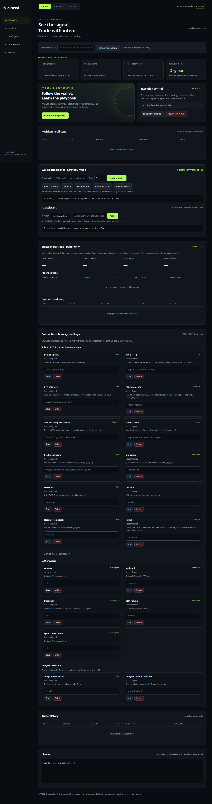

#  Girasol

> Wallet intelligence, controlled copy execution and independent paper strategies.

[](https://github.com/girasolbot/girasolbot/actions/workflows/ci.yml)
[](LICENSE)

**Official links:** [Website](https://girasolbot.com) · [X](https://x.com/girasolbot) · [Support](https://t.me/girasolsupportbot) · [Security](SECURITY.md) · [Product status](docs/PRODUCT_STATUS.md)

[](https://pump.fun/coin/7twNHFHac7y4CzMfYtH6D1M1eDc72v7Czoh1sWUapump)

**🌻 $GIRASOL is LIVE** — [**BUY GIRASOL**](https://pump.fun/coin/7twNHFHac7y4CzMfYtH6D1M1eDc72v7Czoh1sWUapump) · Solana contract (click-to-copy on the website): `7twNHFHac7y4CzMfYtH6D1M1eDc72v7Czoh1sWUapump`

## Chain support

| Chain | Public Rust implementation |
|---|---|
| Solana | Existing supported DEX mirror/replay and risk controls |
| Robinhood | Nitro feed / pending WS / RPC observation, exact-calldata replay with RPC simulation and gated signing |
| Elysium | Same EVM engine, HYPE testnet configuration (`99801`), observed launchpad contracts |
| Elysium mainnet | Configuration template for operator-verified chain ID/endpoints; November 9 launch metadata must be verified before activation |

RPC simulation uses `eth_call` and `eth_estimateGas`. Local `revm` execution is not included. Exact calldata may contain the original recipient or require approvals; a successful simulation does not guarantee an equivalent economic result. Unsupported envelopes fail closed.

Dependency advisories and explicitly deferred upstream migrations are tracked in [Security advisories](docs/SECURITY_ADVISORIES.md).

> [!WARNING]
> The official Girasol token is LIVE on Solana. Historically, before launch, no official Girasol token existed yet; markers retained for trust verification. **No official Girasol token exists yet** clause is superseded by the live launch below. The only verified contract is `7twNHFHac7y4CzMfYtH6D1M1eDc72v7Czoh1sWUapump` — published simultaneously here, on [girasolbot.com/token](https://girasolbot.com/token/) and [@girasolbot](https://x.com/girasolbot). **[BUY GIRASOL](https://pump.fun/coin/7twNHFHac7y4CzMfYtH6D1M1eDc72v7Czoh1sWUapump)**. Any other contract claiming affiliation with Girasol is fraudulent. (Trust verification marker: No official Girasol token exists yet — superseded by this live launch statement.)


Girasol watches a wallet selected by the operator and can mirror supported swaps under explicit risk controls. It uses ShredStream/Geyser or WebSocket detection, pre-built transaction templates and concurrent provider submission to reduce end-to-end latency. Private keys stay in an encrypted local vault, and dry-run mode is enabled by default.

Same-block execution is an engineering objective affected by network conditions, provider latency, validators, transaction construction, priority fees and competing traffic. **It is not a guarantee.** See [Product status](docs/PRODUCT_STATUS.md) for the distinction between public, environment-dependent and experimental capabilities.

- 🔒 your keys, your vault
- 🧪 dry-run first
- ⚡ low-latency execution pipeline

---

## Local dashboard, research and Telegram

```bash
cargo run --release -- --panel-only
```

Open `http://127.0.0.1:8078`, read the generated bearer token from `data/panel-auth-token` locally, and unlock the API in the page. `cargo run` also starts the dashboard when no trading configuration exists. The dashboard runs concurrently with configured trading engines. `SNIPER_DATA_DIR` and `SNIPER_PANEL_BIND` override the local paths/bind; set `VAULT_PASSPHRASE` for passphrase-backed encryption.



Choose **Solana / Robinhood / Elysium** for separate RPC and tip endpoint settings, positions, trade history and logs. Wallet signing keys, provider keys, LLM keys and Telegram credentials are stored in the encrypted vault. Changes to execution endpoints/signing keys require an engine restart. Research reads the current vault settings.

- **Full copy:** Solana supported-swap mirror/replay; EVM original destination/value/calldata with own signer and nonce, simulation and explicit limits. This cannot guarantee arbitrary target transactions succeed from another wallet.
- **Strategy research:** load a target's bounded real history (days/weeks), inspect timing, observed routes, conservative matched round trips, post-loss behaviour and coverage confidence. Generate a paper strategy; independent native-quoted market observations drive entries and TP/SL rather than copying each target transaction. Paper results exclude market impact, fees and slippage.
- **Underworld:** observed transfer counterparties and routes, probable relationships, and optional operator-provided exchange labels. Relationships do not establish common ownership.
- **Daily refresh:** saved targets are re-analyzed and ranked by evidence confidence and observed failure rate. Confidence measures evidence coverage, not investment success.
- **LLM:** local deterministic research works without a key. Optional OpenAI, Anthropic, DeepSeek, GLM and Qwen use your own vaulted keys. A free, unauthenticated DeepSeek V4 service has not been verified and is not advertised as available.
- **Telegram:** save `telegram-bot-token` and `telegram-chat-id` in the panel. The assistant polls only when configured and responds only to allowlisted chats. `/status`, `/profile NETWORK ADDRESS DAYS`, `/strategy`, `/paper`, `/underworld`, `/ask` support research and paper trading. Live activation stays in the authenticated panel.

For EVM, copy the appropriate [configuration](configs/evm.robinhood.toml), set target/copy addresses and limits, then run:

```bash
cargo run --release -- --evm-config configs/evm.robinhood.toml
```

Elysium needs an operator-supplied RPC endpoint; see [testnet](configs/evm.elysium.toml) and [mainnet preparation](configs/evm.elysium-mainnet.toml). Never substitute an unknown mainnet ID or a testnet contract address. See [v3 operations](docs/V3_OPERATIONS.md) for APIs, data coverage and limits.

## How it works

```
┌────────────────────────────────────────────────────────────────────┐
│ listeners (pick one or combine — first detection wins)             │
│   shreds_listener   — Jito-style ShredStream gRPC (pre-block)      │
│   geyser_listener   — Yellowstone gRPC, direct tx parse            │
│   ws_listener       — logsSubscribe WebSocket fallback             │
└──────────────┬─────────────────────────────────────────────────────┘
               ▼
        copy_engine.rs
        target-wallet match, BUY/SELL discriminator parse,
        DEX detect (PumpFun / PumpSwap / Raydium V4 / CPMM)
               ▼
        buy executor ── blockhash cache (400ms refresh)
               │            leader cache, buy template (pre-built)
               ▼
        helius_sender.rs — transaction submission via Helius RPC
        (compute budget, tips, signing, send)
               ▼
        position_monitor.rs — TP/SL levels, mirror sells,
        positions.json persistence, duplicate protection
```

**Highlights**

- **Multi-listener detection** — ShredStream (raw shreds before block
  formation), Yellowstone gRPC Geyser, or plain WebSocket; run them in
  parallel, first detection wins, duplicate signatures deduped.
- **Pre-built transaction templates** — all mint-independent values are
  computed once at startup; per-trade work is a local PDA derivation.
- **Fast submission** — pre-signed transactions sent directly over Helius
  RPC with pre-computed tips; blockhash cache keeps per-trade work minimal.
- **DEX support** — PumpFun, PumpSwap, Raydium V4, Raydium CPMM (buy + sell).
- **Risk management** — multi-level TP/SL, mirror sells, duplicate-buy
  protection, max-positions enforcement, position persistence.
- **API-key panel** — encrypted local vault (AES-256-GCM) for every provider
  key, masked display, bearer-auth REST + web UI. See
  [INSTALL.md](INSTALL.md#api-key-panel).
- **Shared vault** — one `apikeys.enc.json` (vault v2, scrypt) serves BOTH
  the Rust (Solana) and TS (EVM) bots. See the section below.
- **Dry-run by default** — no transaction is submitted unless you explicitly
  enable real mode.

## Shared vault

The API-key vault is **shared between both girasol bots** — the Rust Solana
bot (this repo) and the TS EVM bot (robinhood-bot-aws) read and write the
same `data/apikeys.enc.json` in the unified **vault v2** format:

```json
{
  "version": 2,
  "kdf": "scrypt",
  "kdf_params": { "N": 16384, "r": 8, "p": 1 },
  "salt": "<32-byte hex salt>",
  "slots": { "<slot_id>": { "iv": "<12-byte hex>", "ct": "<hex>", "tag": "<16-byte hex>" } }
}
```

- One file (`<DATA_DIR>/apikeys.enc.json`), one
  [`VAULT_PASSPHRASE`](INSTALL.md#api-key-panel) env var for both bots.
  Run both bots with the same `VAULT_PASSPHRASE`, or neither — otherwise
  the other bot's keys become undecryptable. This Rust implementation refuses
  migration/writes when existing entries cannot be decrypted; restore the
  original passphrase before changing the vault.
- AES-256-GCM per slot; the AES key is `scrypt(passphrase, salt, 32)` with
  `N=16384, r=8, p=1` (identical in Rust and TS implementations).
- Legacy **v1** files (the old per-slot-salt Rust layout and the old
  single-salt TS layout) are still readable; the first write converts the
  whole file to v2, preserving every stored key.

Slot catalog (every slot carries a `network` field: `evm`, `solana` or
`both`):

| Slot | Network | Used for |
|---|---|---|
| `rpc-http` | solana | JSON-RPC reads (config `solana_rpc_urls`) |
| `rpc-wss` | solana | logsSubscribe feed (config `solana_ws_urls`) |
| `erpc` | solana | low-latency edge RPC / WSS |
| `geyser` | solana | Yellowstone gRPC stream |
| `shreds` | solana | ShredStream |
| `zerox` | evm | 0x swap quotes (TS bot) |
| `dexscreener` | evm | token metadata (TS bot) |
| `coingecko` | evm | price/metadata (TS bot) |
| `alchemy` | evm | archive/enhanced RPC (TS bot) |
| `quicknode` | evm | dedicated RPC (TS bot) |
| `infura` | evm | backup RPC (TS bot) |
| `explorer` | evm | Blockscout API (TS bot) |
| `helius` | **both** | transaction sender + enhanced RPC — one shared slot |

Cross-bot round-trip is covered by a fixed test vector
(passphrase `roundtrip-test-1234`, slot `alchemy`, value `sk-test-vector-00`):
each repo's test-suite writes a v2 file "as the other bot would" and reads it
back — see `test_roundtrip_ts_written_v2_file` here and the mirror test in
the TS bot's `tests/api-key-vault.test.ts`.

## Repository layout

```
src/
  main.rs             orchestration, executors, shutdown/stats
  shreds_listener.rs  ShredStream gRPC listener (prost structs, no codegen)
  geyser_listener.rs  Yellowstone gRPC listener, direct tx parsing
  ws_listener.rs      logsSubscribe WebSocket listener
  copy_engine.rs      target-wallet detection + DEX parsing
  buyer.rs / tx_template.rs / tx_builder.rs   buy path
  helius_sender.rs    transaction submission (RPC)
  helius_sender.rs    single-provider submission, tips, CU pricing
  quic_sender.rs      bloXroute (mTLS QUIC) + NextBlock (QUIC) senders
  rpc.rs              price/liquidity fetch, sell flow
  raydium_v4.rs / raydium_cpmm.rs / pumpswap.rs   DEX execution
  position_monitor.rs TP/SL + persistence
  api_key_vault.rs    encrypted API-key vault (AES-256-GCM)
  key_panel.rs / panel.html   authenticated dashboard and provider settings
  runtime.rs          shared live gate and local event journal
  evm.rs / evm_tx.rs   EVM listeners, simulation, envelopes and signing
  intelligence.rs     observed history, profiles and paper strategies
  telegram.rs         allowlisted research assistant
proto/                ShredStream / shared proto definitions (reference)
idl/                  PumpFun IDL files
config.example.toml   example configuration (placeholders only)
```

## Requirements

- Rust stable (validated with Rust 1.96)
- A Solana RPC endpoint (free public RPC works; low-latency providers are
  better — see [INSTALL.md](INSTALL.md#where-to-get-keys))
- Optional: ShredStream / Geyser access for the fastest detection paths

## Quick start

```bash
git clone https://github.com/girasolbot/girasolbot.git girasol && cd girasol
cp config.example.toml config.toml
# edit config.toml: set your target_wallet, RPC/WSS URLs
cargo run --release          # dry-run mode (default)
```

Full setup instructions — including where to get each key, the API-key
panel, and safe real-mode steps — are in [INSTALL.md](INSTALL.md).

## Safety

- `dry_run = true` by default. Real submissions require `--real`, a vaulted wallet key and a fresh authenticated panel confirmation (`I UNDERSTAND REAL FUNDS ARE AT RISK`). Setting Solana `dry_run=false` alone does not enable live. EVM additionally requires its explicit live configuration and calldata acknowledgement.
- `config.toml`, `positions.json` and the `data/` vault directory are
  gitignored — never commit them.
- No key material is ever logged or returned by the panel in plaintext.

## Legal / disclaimer

This software is provided for research and educational purposes, "AS IS",
without warranty of any kind. Trading crypto assets is risky; you can lose
your entire deposit. You are solely responsible for complying with the laws
of your jurisdiction and with the terms of service of any RPC
provider you use. Nothing in this repository is financial advice, and no
statement here is a promise of performance or profit.

Read the public [Trading Risk Disclosure](https://girasolbot.com/risk) before enabling real execution.

## License

MIT — see [LICENSE](LICENSE).
